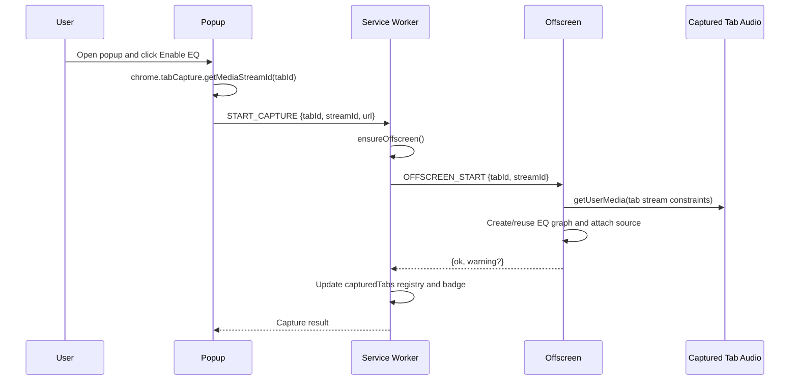

# SonicEQ – Audio Equalizer

SonicEQ is a Manifest V3 Chrome extension that applies a 10-band equalizer to audio playing in a browser tab. It uses `chrome.tabCapture` and an offscreen document to process tab audio without injecting content scripts into web pages.

## Overview

### Purpose
Provide per-tab audio equalization with presets, manual tuning, and live feedback while keeping audio playback stable when the popup closes or the service worker is suspended.

### Problems addressed
- Adjusting tab audio (music, video, streams, local media) with a configurable EQ curve
- Applying reusable built-in and custom presets
- Persisting EQ/settings across sessions
- Handling tab-capture constraints and fullscreen behavior for captured tabs

### Target use cases
- Users who want to boost/cut bass, treble, or vocal ranges for a specific tab
- Speech/podcast clarity, night listening, or genre-oriented EQ presets
- Developers maintaining or extending a MV3 audio-processing extension

### Key capabilities
- 10-band peaking EQ (31 Hz–16 kHz) with preamp and limiter
- 21 built-in presets and user-defined custom presets
- Real-time parameter updates and analytic response curve visualization
- Live spectrum visualization from the processed output (when available)
- Configuration import/export and preset import/export
- English/Vietnamese UI with browser-language fallback

## Features

### Audio processing
- **10-band equalizer**: Bands at 31, 62, 125, 250, 500, 1000, 2000, 4000, 8000, 16000 Hz (`BAND_FREQUENCIES` in [`src/types/index.ts`](src/types/index.ts)).
- **Preamp**: Adjustable gain applied before bands; clamped to ±12 dB.
- **Bypass behavior**: When EQ is disabled, bands/preamp are driven to neutral and limiter is set to no-op without disconnecting the graph (`Equalizer.applyState` in [`src/audio/Equalizer.ts`](src/audio/Equalizer.ts)).
- **Limiter**: Optional dynamics-compressor safety stage (enabled by default in settings).
- **Smooth parameter changes**: Gain/Q/preamp updates use `setTargetAtTime` with configurable smoothing.
- **EQ range setting**: UI/stored gain range constrained to ±6, ±12, or ±18 dB.

### Presets and tuning
- **Built-in presets (21)**: Defined in [`src/presets/defaultPresets.ts`](src/presets/defaultPresets.ts) (Flat, Bass Boost, Deep Bass, Treble Boost, Vocal Boost, Podcast, Speech Clarity, Pop, Rock, EDM, Hip-Hop, Classical, Jazz, Acoustic, Gaming, Movie, Night Mode, Loudness, Bright, Warm, Relax).
- **Custom presets**: Create from current curve, rename/edit description/category, duplicate, delete (built-ins are read-only).
- **Favorites**: Mark presets as favorites for quicker access.
- **Per-band controls**: Vertical sliders, direct dB input, and per-band reset in popup/options curve editor.
- **Default preset/reset behavior**: Reset returns to configured default preset; full reset restores defaults while preserving the `defaultEnabled` preference logic implemented in [`src/store/eqStore.ts`](src/store/eqStore.ts).

### Tab capture and session behavior
- **Per-tab capture**: Popup obtains a `tabCapture` stream ID (user gesture/`activeTab`) and background coordinates offscreen processing.
- **Offscreen audio host**: Audio graph and captured streams live in [`src/offscreen/offscreen.ts`](src/offscreen/offscreen.ts), surviving popup close and service worker suspension.
- **Capture registry**: Active captures tracked in `chrome.storage.session` (`capturedTabs`) and reconciled by the service worker.
- **Badge/status**: Extension badge reflects active capture count.
- **Best-effort auto-enable**: Optional setting attempts auto-capture on completed navigations only when `activeTab`/capture prerequisites allow; failures are silent.

### Visualization and UI
- **Response graph**: Analytic EQ magnitude curve rendered in UI (`computeEqCurve` in [`src/utils/eqResponse.ts`](src/utils/eqResponse.ts)).
- **Live spectrum**: Polls offscreen analyser data while popup is open and capture is active; shows idle/silent states instead of fabricated data.
- **Popup**: Enable/stop capture for current tab, preset selection, EQ toggle, graph, band sliders, preamp, visualizer, import/export dialogs, theme/language quick toggles.
- **Options page**: Defaults, audio/behavior settings, curve editor, preset library management, full config import/export/reset.

### Import/export and localization
- **Preset JSON export/import**: Single-preset files validated before apply.
- **Full config JSON export/import**: Sanitized through tolerant validation (`sanitizePersistedState` / `parseConfigJson`).
- **Languages**: `en`, `vi`, and `system` (browser UI language). UI strings are managed in [`src/i18n/`](src/i18n/).
- **Manifest localization**: Extension description uses `_locales` (`__MSG_extDescription__`).

### Fullscreen bridge (captured tabs)
- Service worker injects a fullscreen watcher into captured tabs and attempts to synchronize window fullscreen state when page fullscreen is downgraded during capture. Includes fallback/status handling and restore logic (see [`src/background/service-worker.ts`](src/background/service-worker.ts) and [`scripts/verify-fullscreen-bridge.mjs`](scripts/verify-fullscreen-bridge.mjs)).

## Technology Stack

| Category | Details |
| --- | --- |
| Language | TypeScript (`strict`), TSX/React, JavaScript (Node build/utility scripts), CSS, HTML, JSON |
| UI | React 18, `react-dom` |
| Build tooling | Vite 7, `@vitejs/plugin-react`, TypeScript compiler (`tsc`) |
| Icons/UI assets | `lucide-react`, generated PNG icons via [`scripts/generate-icons.mjs`](scripts/generate-icons.mjs) |
| Platform/APIs | Chrome Extension Manifest V3, `chrome.tabCapture`, `chrome.offscreen`, `chrome.storage` (`local`, `session`), `chrome.runtime`, `chrome.tabs`, `chrome.windows`, `chrome.action`, `chrome.scripting`, `chrome.i18n` |
| Audio | Web Audio API (`AudioContext`, `BiquadFilterNode`, `GainNode`, `DynamicsCompressorNode`, `AnalyserNode`, `MediaStreamSource`) |

## Project Structure

```text
.
├── .gitignore
├── offscreen.html
├── options.html
├── package.json
├── popup.html
├── public/
│   ├── _locales/
│   │   ├── en/messages.json
│   │   └── vi/messages.json
│   ├── icons/                    # generated by scripts/generate-icons.mjs
│   └── manifest.json
├── scripts/
│   ├── _audit.mjs                # source/reference audit utility
│   ├── generate-icons.mjs        # generates extension PNG icons
│   └── verify-fullscreen-bridge.mjs  # smoke check for built service worker fullscreen bridge
├── src/
│   ├── audio/                    # audio engine, EQ graph, presets logic, visualizer
│   ├── background/               # service worker (capture orchestration, registry, fullscreen bridge)
│   ├── hooks/                    # React hooks for state, theme, active tab, capture status, toasts
│   ├── i18n/                     # catalogs and translation helpers
│   ├── offscreen/                # offscreen audio host entry
│   ├── options/                  # options page UI and styles
│   ├── popup/                    # popup UI and styles
│   ├── presets/                  # built-in preset definitions
│   ├── store/                    # UI/store synchronization and persistence
│   ├── styles/                   # shared/base CSS
│   ├── types/                    # shared types/constants
│   └── utils/                    # storage, validation, messaging, math/format/helpers
├── tsconfig.json
└── vite.config.ts
```

### Notable files
- [`public/manifest.json`](public/manifest.json): MV3 manifest, permissions, entry points
- [`vite.config.ts`](vite.config.ts): multi-entry build (popup/options/offscreen/background)
- [`src/background/service-worker.ts`](src/background/service-worker.ts): capture lifecycle, registry, badge, fullscreen bridge, reconciliation
- [`src/offscreen/offscreen.ts`](src/offscreen/offscreen.ts): audio host, live/state application, visualization responses
- [`src/audio/AudioEngine.ts`](src/audio/AudioEngine.ts): per-tab stream sources and EQ graph ownership
- [`src/audio/Equalizer.ts`](src/audio/Equalizer.ts): Web Audio processing chain
- [`src/store/eqStore.ts`](src/store/eqStore.ts): persisted UI state, throttled writes, live broadcasts

## Requirements

- **Node.js and npm**: Required to install dependencies and run build scripts (versions not pinned in repository config; use a current LTS Node.js version compatible with Vite 7/TypeScript tooling).
- **Browser**: Chromium-based browser supporting the extension APIs used here. Manifest declares `minimum_chrome_version`: **116**.
- **Permissions granted by extension** (from manifest): `storage`, `tabCapture`, `offscreen`, `activeTab`, `scripting`.
- **No external services/accounts** are required for normal operation.

## Installation

1. Install dependencies:
   ```bash
   npm install
   ```
2. Build the extension:
   ```bash
   npm run build
   ```
   This runs icon generation (`prebuild`) and outputs the loadable extension to `dist/`.
3. Load into Chrome/Edge:
   - Open `chrome://extensions` (or `edge://extensions`)
   - Enable **Developer mode**
   - Click **Load unpacked**
   - Select the `dist/` directory

## Configuration

### Runtime/user configuration (UI)
Configuration is managed in the popup and options page (not via `.env` files):

- **Defaults**: default preset, EQ enabled by default, language, theme, compact layout, EQ range
- **Audio**: Q factor, smoothing time, limiter, visualization
- **Behavior**: auto-enable on new tabs (best-effort)
- **Presets/config**: custom preset management, preset/config import/export, reset actions

### Persisted data
- **`chrome.storage.local` key `soniceq`** (`STORAGE_KEY`): persisted EQ state, settings, favorites, custom presets, schema version
- **`chrome.storage.session` key `capturedTabs`** (`CAPTURED_TABS_KEY`): active capture registry (survives service worker restarts/suspension)
- Stored/imported data is sanitized with tolerant validation in [`src/utils/validation.ts`](src/utils/validation.ts).

### Localization
- UI catalogs: [`src/i18n/en.ts`](src/i18n/en.ts), [`src/i18n/vi.ts`](src/i18n/vi.ts), [`src/i18n/presets.ts`](src/i18n/presets.ts)
- Manifest description localization: [`public/_locales/en/messages.json`](public/_locales/en/messages.json), [`public/_locales/vi/messages.json`](public/_locales/vi/messages.json)

### Environment variables / secrets
- No `.env` configuration is used by the project.
- No API keys, tokens, or credentials are required.

## Usage

### Run/develop locally
- **Watch build (development mode)**:
  ```bash
  npm run dev
  ```
  Runs icon generation (`predev`) and `vite build --watch --mode development`. After changes rebuild to `dist/`, reload the unpacked extension in `chrome://extensions`.
- **Production build**:
  ```bash
  npm run build
  ```
- **Type checking**:
  ```bash
  npm run typecheck
  ```
- **Fullscreen bridge smoke check** (requires a prior build):
  ```bash
  npm run verify:fullscreen
  ```

### Using the extension
1. Open a tab playing audio (e.g. web media player).
2. Click the SonicEQ extension icon (popup). Opening the popup provides the user gesture/`activeTab` context needed for capture.
3. Click **Enable EQ for this tab**.
4. Adjust preset, bands, preamp, and settings as needed. Changes are applied live and persisted.
5. Use **Stop** in the popup to stop processing that tab, or close/reload behavior follows capture/tab lifecycle rules handled by the service worker.

### Notes on behavior
- Capture is tab-scoped; each captured tab gets its own media stream source in the offscreen engine.
- The popup must be used to initiate capture in normal cases (`getMediaStreamId` requires `activeTab`).
- “Auto-enable EQ on new tabs” is best-effort and only works when capture prerequisites are already satisfied.

## Architecture and Workflow

### High-level architecture
- **Popup / Options (React UIs)**: Read/write persisted state via store, send control messages, render controls/visualizations.
- **Background service worker** (`src/background/service-worker.ts`): Single coordinator for capture requests, offscreen lifecycle, capture registry, badge updates, tab events, fullscreen bridge.
- **Offscreen document** (`src/offscreen/offscreen.ts`): Owns `AudioContext`, EQ processing graph, analyser, and applies state updates from messages/storage.
- **Audio modules** (`src/audio/*`): Engine/source management, EQ chain, preset logic, spectrum downsampling.
- **State/persistence** (`src/store/eqStore.ts`, `src/utils/storage.ts`, `src/utils/validation.ts`): Sanitized persistence, throttled writes, live EQ broadcast.

### Main execution flow (capture)


### State synchronization
- UI edits update in-memory store immediately, broadcast `EQ_LIVE` for low-latency offscreen updates, and persist to `chrome.storage.local` with throttling.
- Offscreen also listens to storage changes as a fallback/reconciliation path.

### Internal messaging (no external HTTP API)
Message types are defined in [`src/types/index.ts`](src/types/index.ts), including:
- Control: `START_CAPTURE`, `STOP_CAPTURE`, `GET_STATUS`
- Offscreen control: `OFFSCREEN_START`, `OFFSCREEN_STOP`, `OFFSCREEN_SHUTDOWN`
- Live updates: `EQ_LIVE`
- Visualization: `VIZ_REQUEST`
- Fullscreen bridge: `PAGE_FULLSCREEN`

## API Documentation

This project does not expose an external HTTP/REST API. Interaction is performed through the browser extension UI and internal `chrome.runtime` messaging between extension contexts (popup/options, background service worker, offscreen document, and injected fullscreen watcher).

## Testing

### Automated tests
- No automated unit/integration test suite is currently included in the repository (no `test` script in [`package.json`](package.json)).

### Verification commands
- **Type check**:
  ```bash
  npm run typecheck
  ```
- **Build**:
  ```bash
  npm run build
  ```
- **Fullscreen bridge smoke check** (loads built `dist/background/service-worker.js` with mocked `chrome.*` APIs; run after build):
  ```bash
  npm run verify:fullscreen
  ```

## Troubleshooting

| Issue | Possible cause | Suggested action |
| --- | --- | --- |
| Cannot enable EQ on a page | Protected/restricted pages (e.g. `chrome://*`, extension pages, Chrome Web Store) cannot be captured | Use a regular `http(s)` page with playable audio |
| Capture fails unless popup button is clicked | `tabCapture.getMediaStreamId` requires `activeTab`/user gesture; auto-enable is best-effort | Open the popup on the target tab and enable manually |
| Tab becomes silent after capture attempt | Audio context suspended or capture/stream issue | Re-enable capture; check popup warning/status; inspect extension service worker/offscreen logs |
| Fullscreen behavior differs on captured tab | Chrome may downgrade page fullscreen during capture; bridge depends on injection and browser behavior | Reload extension after permission/build changes, re-enable capture on tab, or use browser/window fullscreen (F11) |
| Fullscreen bridge stops after cross-origin navigation | Injected watcher and `activeTab` grant do not persist across cross-origin navigations | Re-open popup and enable EQ for the tab again to re-inject watcher |
| Imported preset/config rejected | Invalid JSON or invalid schema/values | Verify file format/content; imports are validated/sanitized before apply |
| Build/watch changes not reflected | Extension not rebuilt/reloaded | Run `npm run dev` or `npm run build`, then reload unpacked extension in `chrome://extensions` |

### Diagnostic logs (fullscreen bridge)
- Page console: `[soniceq] page fullscreen -> ...` / fullscreen refusal message (from injected watcher)
- Service worker console (`chrome://extensions` → extension service worker): `[soniceq] drove window to fullscreen -> ...`, injection/update warnings, and other bridge diagnostics

## Security Notes

- **Permissions scope**: Manifest requests only the permissions needed for capture/processing and UI coordination (`storage`, `tabCapture`, `offscreen`, `activeTab`, `scripting`); no broad `host_permissions` are declared.
- **No credentials/secrets**: The extension does not require API keys or external credentials. Do not add secrets to source, manifests, or exported config files.
- **Input handling**: Imported preset/config data is treated as untrusted and validated/sanitized before use.
- **Local data storage**: EQ/config state and capture registry are stored in browser extension storage (`local`/`session`).
- **Operational caution**: Boosting multiple bands can increase clipping risk; limiter reduces but does not eliminate distortion. Use preamp appropriately.

## License

This project is licensed under the MIT License. See [LICENSE](LICENSE) for details.

## Contribution

1. Review the implementation and architecture sections above.
2. Make focused changes consistent with existing patterns (TypeScript strict mode, `@/` alias for `src/` imports, existing module boundaries).
3. Validate changes with:
   ```bash
   npm run typecheck
   npm run build
   ```
4. If modifying fullscreen bridge behavior, also run:
   ```bash
   npm run verify:fullscreen
   ```
5. Update documentation when behavior, scripts, permissions, or structure change.
